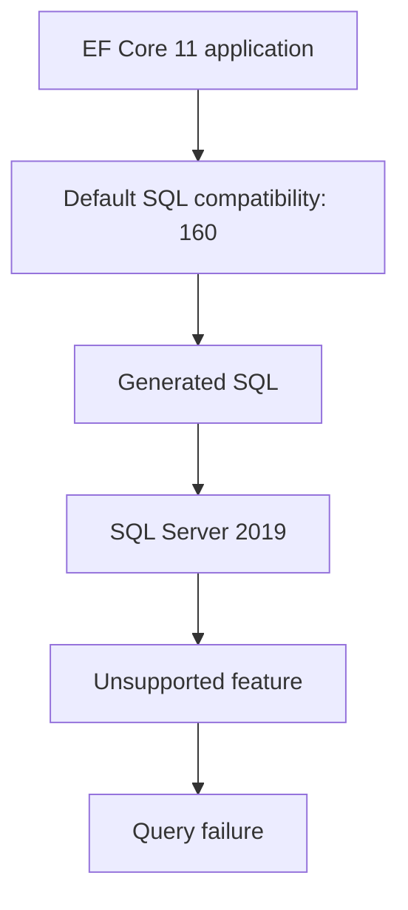
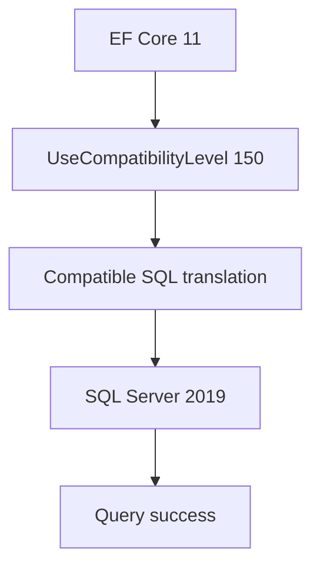

# EF Core 11 SQL Server compatibility level

An EF Core upgrade can succeed while generated SQL still breaks against your production database.

EF Core 11 changes the SQL Server provider default from compatibility level **150** to **160**. Level 160 allows SQL Server 2022 translations such as `LEAST`. This Order Management API compiles and runs on .NET 11 either way. Against SQL Server 2019, the default translation of `Math.Min` over two order amounts is rejected. Setting `UseCompatibilityLevel(150)` makes EF Core generate SQL that the older engine can run.

This is a focused reproduction and upgrade guide. It is not a general EF Core tutorial, and it is not a production system.

## The developer problem

Development:

- .NET 11
- EF Core 11
- SQL Server 2022, or any engine that accepts `LEAST`
- Database compatibility level 160 is possible there

Production-like environment in this repo:

- .NET 11
- EF Core 11
- SQL Server 2019 (`mcr.microsoft.com/mssql/server:2019-latest`)
- A new database on that engine is compatibility level 150
- That engine cannot be set to 160, and it does not implement `LEAST`

The same binary and the same LINQ query are deployed to both. Only the database engine differs. Local success does not prove the production engine can execute the SQL.

## What changed in EF Core 11

Documented in [Breaking changes in EF Core 11](https://learn.microsoft.com/en-us/ef/core/what-is-new/ef-core-11.0/breaking-changes) and summarized in [What's new](https://learn.microsoft.com/en-us/ef/core/what-is-new/ef-core-11.0/whatsnew):

| EF Core | `UseSqlServer` without an explicit compatibility level |
| --- | --- |
| 10 | 150, the SQL Server 2019 level |
| 11 | 160, the SQL Server 2022 level |

The provider then uses SQL Server 2022 features for some translations: `LEAST`, `GREATEST`, `Math.Min`, `Math.Max`, and some `Take` / `Skip` shapes. Queries that do not need those translations are unchanged. `GET /api/orders` is one of those.

The official mitigation is `UseCompatibilityLevel` on the provider. It does not upgrade SQL Server and it does not change `sys.databases.compatibility_level`.

## Why SQL Server 2019 fails

`LEAST` exists on SQL Server 2022 (16.x) and later. SQL Server 2019 is engine 15.x, and its highest database compatibility level is 150.

On image `mcr.microsoft.com/mssql/server:2019-latest` this project observed:

```text
Microsoft SQL Server 2019 (RTM-CU32-GDR) (KB5132745) - 15.0.4510.2 (X64)
Developer Edition (64-bit) on Linux (Ubuntu 20.04.6 LTS)
```

A new database `OrderManagement` on that instance reported `compatibility_level` 150. Sending `LEAST` produced:

```text
Msg 195, Level 15, State 10
'LEAST' is not a recognized built-in function name.
```

Database compatibility level and engine version are not the same knob. Details, including what was not tested on SQL Server 2022, are in [docs/CompatibilityLevels.md](docs/CompatibilityLevels.md).

## Before and after

The discount rule is fictional and deliberate: the effective discount is the lesser of `TotalAmount` and `DiscountLimit`.

```csharp
EffectiveDiscount = Math.Min(order.TotalAmount, order.DiscountLimit)
```

### Before

```csharp
builder.Services.AddDbContext<AppDbContext>(options =>
    options.UseSqlServer(connectionString));
```

EF Core 11 targets provider level 160. `ToQueryString()` returns:

```sql
SELECT [o].[Id] AS [OrderId], [o].[OrderNumber], [o].[CustomerName], [o].[TotalAmount], [o].[DiscountLimit], LEAST([o].[TotalAmount], [o].[DiscountLimit]) AS [EffectiveDiscount]
FROM [Orders] AS [o]
ORDER BY [o].[OrderNumber]
```

### After

`SqlServer:CompatibilityLevel` is 150 in configuration. Startup passes it through:

```csharp
options.UseSqlServer(connectionString, sql => sql.UseCompatibilityLevel(150));
```

`ToQueryString()` returns:

```sql
SELECT [o].[Id], [o].[OrderNumber], [o].[CustomerName], [o].[TotalAmount], [o].[DiscountLimit]
FROM [Orders] AS [o]
ORDER BY [o].[OrderNumber]
```

EF Core reads the two amounts and evaluates `Math.Min` while materializing the response. Seeded results are `ORD-1001 = 20.00`, `ORD-1002 = 15.00`, and `ORD-1003 = 40.00`.

`Math.Min` inside `Where` is not given a level 150 translation. That shape throws `InvalidOperationException` in EF Core instead of reaching the server. The API uses the final projection, which can complete after the query. See [docs/GeneratedSqlComparison.md](docs/GeneratedSqlComparison.md).

| Configuration | Provider compatibility | Generated SQL | SQL Server 2019 | Result |
| --- | --- | --- | --- | --- |
| `UseSqlServer(connectionString)` | 160 | `LEAST(TotalAmount, DiscountLimit)` | Engine 15.0.4510.2, database level 150 | Message 195, `LEAST` is not a recognized function |
| `UseCompatibilityLevel(150)` | 150 | Columns only, no `LEAST` | Same engine and database level | Query succeeds. Discounts 20.00, 15.00, 40.00 |

## What fails, then what works





## Verify the engine and the database

`GET /api/diagnostics/sql-server` runs, in Development only:

```sql
SELECT @@VERSION;

SELECT
    name,
    compatibility_level
FROM sys.databases
WHERE name = DB_NAME();
```

The response also includes `SERVERPROPERTY` values and the EF provider level. It does not include the connection string.

## Run it locally

Prerequisites:

- .NET SDK 11.0.100, or a later 11.0 feature band, visible to `dotnet --list-sdks`. `global.json` pins that band. Install it from https://dotnet.microsoft.com/download/dotnet/11.0 if the host only shows older SDKs.
- Docker, with enough memory for one SQL Server container (about 2 GB)

The development password is `DevOnly_Sql2019!`. It is only for the local container. It is in `appsettings.Development.json`, `docker-compose.yml`, and `.env.example`. Do not reuse it anywhere else. If you set `MSSQL_SA_PASSWORD`, change the connection string to the same value. No production secret belongs in this repo.

```bash
docker compose up -d --wait
dotnet tool restore
dotnet restore
dotnet build
dotnet test
dotnet run --project src/EfCoreCompatibility.Api
```

`dotnet tool restore` installs local `dotnet-ef` 11.0.0 from `dotnet-tools.json`.

Compose publishes SQL Server 2019 on `localhost:1433`. On startup in Development the API applies the EF migration, which creates `OrderManagement`, the `Orders` table, and three fictional orders. It does not change the database compatibility level.

If port 1433 is already taken, change the host port and `Server=localhost,1433` together. Leave other Docker containers alone.

Optional SQL Server 2022 comparison, host port 14332:

```bash
docker compose --profile comparison up -d
```

Point a separate connection string at that port only when you intend to test a newer engine. The checked-in Development settings stay on the 2019 port and provider level 150.

Stop the sample's containers with:

```bash
docker compose down
docker compose --profile comparison down
```

That removes only this Compose project. It does not delete unrelated containers or volumes. The database is recreated by migrations the next time the API starts.

## Configuration

| File | When it loads | Provider level | Migrations on startup |
| --- | --- | --- | --- |
| `appsettings.json` | Always | 150 | false |
| `appsettings.Development.json` | `Development` | 150, local SQL Server 2019 connection | true |
| `appsettings.Legacy.json` | `ASPNETCORE_ENVIRONMENT=Legacy` | 150 | false |
| `appsettings.Modern.json` | `ASPNETCORE_ENVIRONMENT=Modern` | 160 | false |

Legacy and Modern do not contain a password. Supply `ConnectionStrings__Orders` in the environment. Startup rejects a missing connection string and a compatibility level outside 80, 90, 100, 110, 120, 130, 140, 150, 160, and 170.

Explicit configuration makes the EF Core 11 upgrade predictable: the SQL dialect is chosen in source control instead of changing silently with the package default.

## Migrations

```bash
dotnet tool run dotnet-ef -- database update --project src/EfCoreCompatibility.Api
```

Development startup already calls `Database.MigrateAsync()` when `SqlServer:ApplyMigrationsOnStartup` is true. The migration is `Data/Migrations/20261125093527_InitialOrders.cs`.

## API

Base URL: `http://localhost:5080`

| Method | Path | What it does |
| --- | --- | --- |
| GET | `/api/orders` | Orders. This query does not use `Math.Min`. |
| GET | `/api/orders/effective-discount` | Effective discounts with the configured provider level |
| GET | `/api/orders/effective-discount?orderNumber=ORD-DOES-NOT-EXIST` | Empty list |
| GET | `/api/diagnostics/sql-server` | Engine version and database compatibility level |
| GET | `/api/diagnostics/generated-sql` | Default and configured `ToQueryString()` output |
| GET | `/api/diagnostics/compatibility` | Executes both provider settings and returns the real outcome |
| GET | `/swagger` | Swagger UI |
| GET | `/openapi/v1.json` | Built-in OpenAPI document |

Diagnostic routes and Swagger are registered for the Development environment. In any other environment those diagnostic routes respond with 404, and the response body is not given a connection string. Do not run a shared server with `ASPNETCORE_ENVIRONMENT=Development` if the diagnostics should stay private.

## Tests

```bash
dotnet test
```

Unit tests do not need Docker. They check the provider default of 160, explicit level 150, the SQL difference, the untranslatable `Where` at level 150, configuration validation, and that `docs/sql/before.sql` and `docs/sql/after.sql` still contain the current `ToQueryString()` output.

Integration tests start `mcr.microsoft.com/mssql/server:2019-latest` with Testcontainers, apply the migration, and then:

- read engine major version 15 and database compatibility 150
- execute the default query and assert SQL error 195
- execute the level 150 query and assert the three discounts
- assert an unknown order number returns no rows
- call the API and assert HTTP status codes
- assert Development diagnostics omit the container password
- assert Production does not expose diagnostics
- assert an invalid compatibility level or a missing connection string stops startup

The intentional failure is a passing test: the assertion is that SQL Server rejected `LEAST`.

## Reproduce the failure and the fix

1. Start SQL Server 2019 and the API as above.
2. `GET /api/diagnostics/generated-sql` shows level 160 SQL containing `LEAST` and level 150 SQL without it.
3. `GET /api/diagnostics/compatibility` executes both. `defaultQuery.succeeded` is false, `sqlErrorNumber` is 195, and `configuredQuery` returns the three discounts.
4. `GET /api/orders/effective-discount` uses the configured level 150 path and returns those discounts.
5. `GET /api/diagnostics/sql-server` shows engine 15.x and database compatibility 150.

## Production checklist

The operational list is [docs/ProductionUpgradeChecklist.md](docs/ProductionUpgradeChecklist.md). Short version: inventory engines, read every database's compatibility level, compare generated SQL, test on a production-like engine, set `UseCompatibilityLevel` when 160 is too new, and do not confuse that setting with `ALTER DATABASE`.

## Known limitations

- Level 150 does not rewrite this `Math.Min` projection into a `CASE` expression. The minimum is evaluated by EF Core after the columns are returned. A `Where` that calls `Math.Min` does not translate at level 150.
- Not every query is affected. A single `Take` did not emit `LEAST` on this package. Combined non-constant limits did.
- No performance numbers are claimed. Level 160 is not described as faster.
- SQL Server 2022 with a database still at compatibility level 150 was not executed here. Do not infer that result from the SQL Server 2019 failure.
- When EF Core creates the database during `Migrate`, it also runs `ALTER DATABASE [OrderManagement] SET READ_COMMITTED_SNAPSHOT ON`. That is the provider's normal database-creation behavior. It is not `SET COMPATIBILITY_LEVEL`, and this application never sends a compatibility-level change.
- Azure SQL uses a different provider path and a different default. This sample calls `UseSqlServer` only.
- Diagnostic endpoints are hidden outside Development. That is an environment gate, not authentication.
- The container password is a published development credential.

## License

MIT. See [LICENSE](LICENSE). MIT is a permissive license that fits an educational sample: it allows use, modification, and redistribution, and it keeps the copyright and permission notice with the code. It does not add a copyleft obligation.

## References

- [Breaking changes in EF Core 11](https://learn.microsoft.com/en-us/ef/core/what-is-new/ef-core-11.0/breaking-changes)
- [What's new in EF Core 11](https://learn.microsoft.com/en-us/ef/core/what-is-new/ef-core-11.0/whatsnew)
- [SQL Server provider for EF Core](https://learn.microsoft.com/en-us/ef/core/providers/sql-server/)
- [LEAST (Transact-SQL)](https://learn.microsoft.com/en-us/sql/t-sql/functions/logical-functions-least-transact-sql)
- [ALTER DATABASE compatibility level](https://learn.microsoft.com/en-us/sql/t-sql/statements/alter-database-transact-sql-compatibility-level)
- Tracking issue: https://github.com/dotnet/efcore/issues/38198
